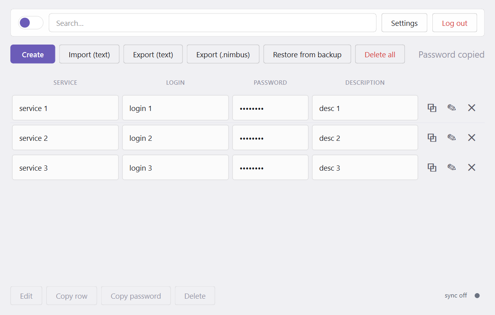
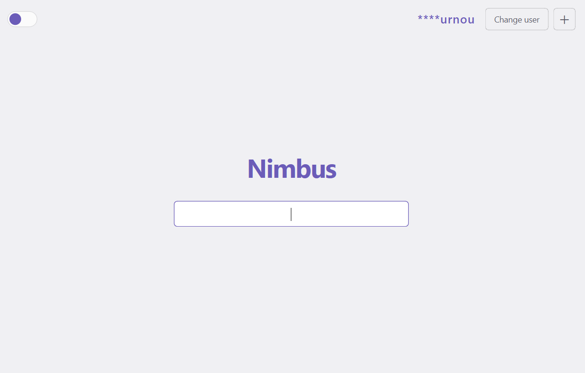
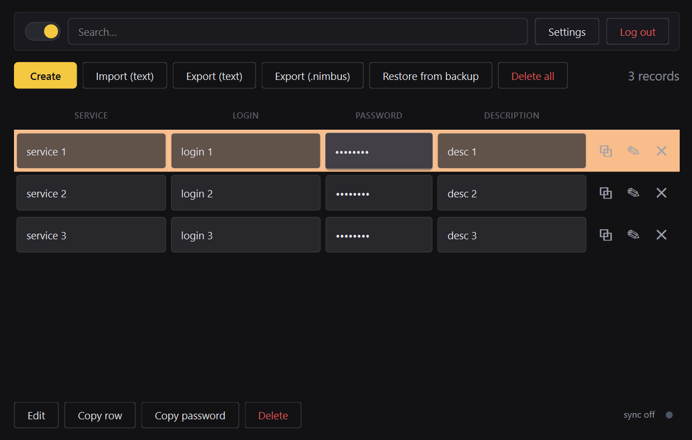
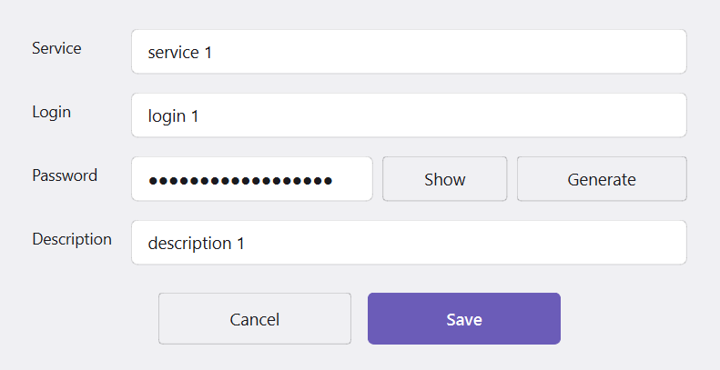
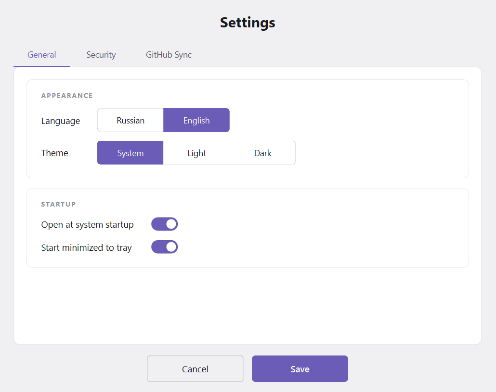
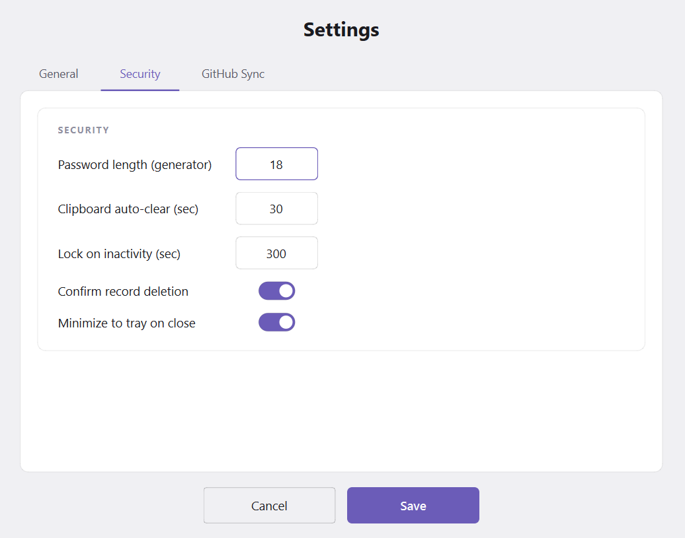
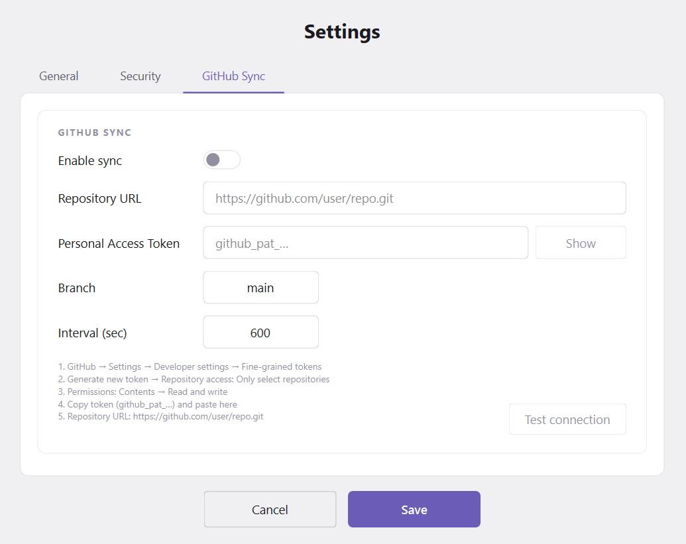

<div align="center">

# ⚡ Nimbus

**Lightweight password manager with encryption, multi-user mode, GitHub sync, and a sleek interface.**

Local storage · AES-128 · PBKDF2-600k · GitHub Sync · Light/Dark themes · RU/EN

[](readme.md)
[](readme.ru.md)

[](https://github.com/birlurnou/nimbus/releases/latest)
[](https://github.com/birlurnou/nimbus/actions/workflows/build.yaml)
[](https://www.python.org/downloads/)
[](https://pypi.org/project/PyQt6/)
[](LICENSE)
[](https://www.microsoft.com/windows)

</div>



---

## ✨ Features

### Security
- **AES-128 (Fernet)** — authenticated encryption of all data (HMAC-SHA256 + AES-CBC).
- **PBKDF2-HMAC-SHA256** with **600,000 iterations** — brute-force resistant master password key derivation.
- **Separate salt** (16 bytes from `secrets`) and **KDF meta-file** — for seamless upgrades without data loss.
- **Atomic writes** of all files via `mkstemp + os.replace` — a process crash won't corrupt the vault.
- **Clipboard auto-clear** after 30 seconds (configurable).
- **Session lock on inactivity** (5 minutes by default) — closes all open dialogs.
- **Failed login delay** — 3 attempts, then exponential backoff (2 → 4 → 8 → 16 → 30 sec).
- **Single-instance lock** — a second copy won't launch and overwrite the first.
- **Safe conflict resolution** — tracks `updated_at` timestamps and uses tombstones (`_deleted_at`) for deleted records to ensure safe synchronization across devices.

### GitHub Sync
- **Cross-device synchronization** — use a private GitHub repository as a secure backend to sync your encrypted vault across home and work PCs.
- **Personal Access Token (PAT) support** — secure HTTPS connection without relying on global git configs.
- **Smart Merge (No data loss)** — if you edit data on two devices, Nimbus resolves conflicts by comparing modification times on a per-record basis.
- **Tombstones for deletion** — deleted records are kept as "tombstones" for 30 days so deletions sync properly without "resurrecting" on other devices.
- **Background processing** — pushes changes immediately after save/update/delete and checks for remote updates every 10 minutes (configurable).
- **Visual Sync Indicator** — animated spinner (`/ \`) during sync, green blinking dot with time for success, and red dot with tooltip for errors.
- **Safe Restore** — prevents pulling old data over newer local data. Warns if a user with the same name but a different master password exists in the remote repository.

### Multi-user mode
- Each user is stored in a **separate folder** `{username}/{username}.nimbus*`.
- **One-password login** — the app iterates through all users and logs into the one whose password matches.
- **«＋»** button on the login screen — quickly create a new user.
- Minimum **10 characters** for the master password.

### Interface
- **Tabbed Settings Dialog** — cleanly separated into **General**, **Security**, and **GitHub Sync** tabs.
- **Live preview** — switching language or theme in settings applies instantly (reverts on cancel).
- **Light and dark themes** + automatic system theme detection.
- **Russian and English** languages (switches on the fly).
- **Status notifications** directly in the main window (no popups).
- **Tray icon** — app runs in the background, logs out on close, and restores on double-click.

### Data Management
- Create, edit, delete records (service / login / password / description).
- **Real-time search** by service, login, and description.
- **Password generator** (18 chars by default, configurable).
- **Copy any field** with a single click.
- **Reveal/hide password** on double-click.
- **Import from CSV** (`;` delimiter).
- **Export to CSV** with BOM marker — Excel opens Cyrillic correctly.
- **Export `.nimbus`** — ZIP archive with encrypted user files for backup.

---

## 📸 Screenshots

### Login Screen
Minimalist one-password login. The **＋** button in the top right creates a new user.



### Main Window — Light Theme
Tiles with records, search, action panel, and the sync indicator at the bottom right.


### Main Window — Dark Theme
Same interface in dark palette (black + yellow accent).



### Create / Edit Record
Service, login, password with generator, and description fields.



### Settings
Three tabs — **General** (language, theme, startup), **Security** (password length, timeouts), and **GitHub Sync** (repo URL, PAT, interval).







---

## 🛠 Dependencies & Requirements

- **Python 3.10+** (3.11–3.13 recommended)
- **PyQt6 ≥ 6.5** — GUI
- **cryptography ≥ 41** — encryption (Fernet + PBKDF2)
- **pyperclip ≥ 1.8** — clipboard (optional, but required to copy passwords)
- **Git** — must be installed and available in `PATH` (required for GitHub Sync).

`requirements.txt`:

```txt
PyQt6>=6.5
cryptography>=41.0
pyperclip>=1.8
```

## 🚀 Quick Start with GitHub Sync

**On your first device (e.g., Home PC):**
1. Create a **private** repository on GitHub (e.g., `your-username/nimbus-data`).
2. Generate a **Fine-grained Personal Access Token (PAT)** in GitHub settings:
   - Repository access: Only select repositories.
   - Permissions: **Contents → Read and write**.
3. Open Nimbus, create a local user (e.g., `alice`), and add a few records.
4. Go to **Settings → GitHub Sync**. Paste the repository URL (`https://github.com/user/repo.git`) and the PAT.
5. Click **Test connection** and then **Save**. Your data will be pushed to GitHub.

**On your second device (e.g., Work PC):**
1. Open Nimbus and click the **«＋»** button on the login screen.
2. Switch to the **Restore from GitHub** tab.
3. Paste the same repository URL and PAT, and click **Restore**.
4. Nimbus will download your encrypted vault. Enter your **original master password** to log in.
5. Go to **Settings → GitHub Sync**, paste the URL and PAT again, test the connection, and save.

Now you can seamlessly add, edit, or delete records on either device. Nimbus will automatically sync changes in the background every 10 minutes (customizable).