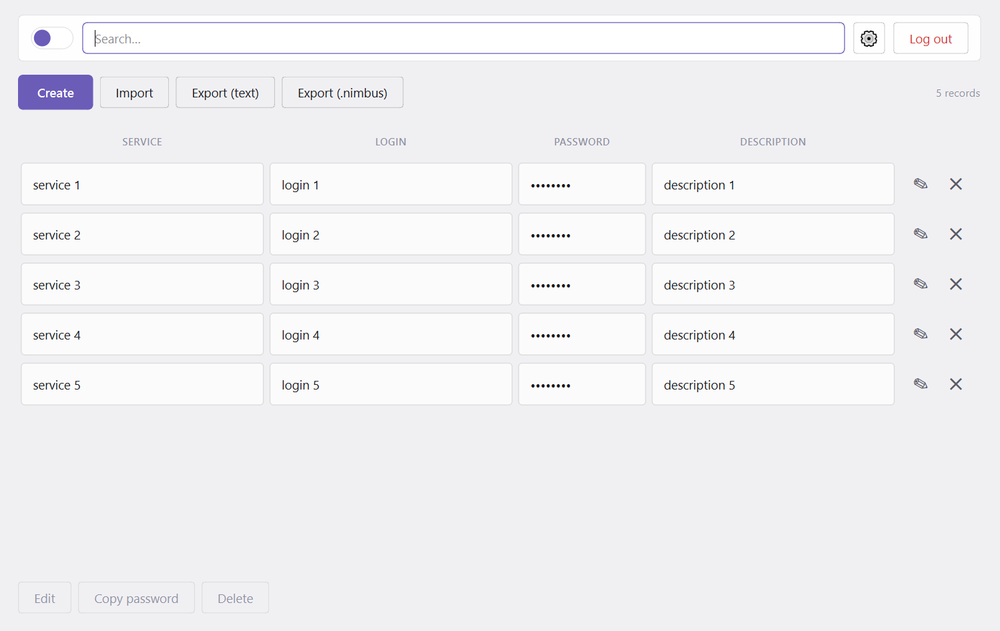
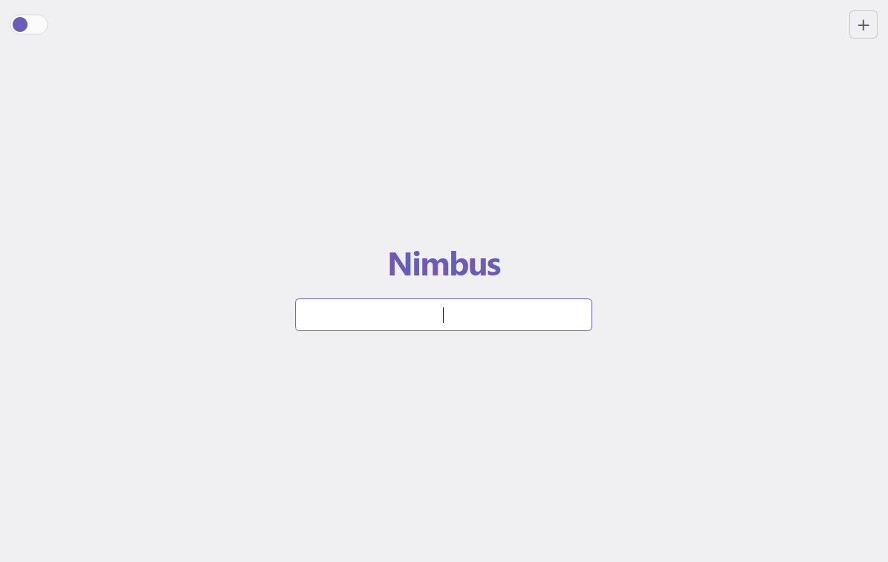
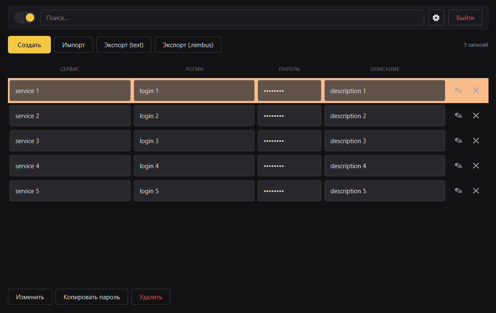
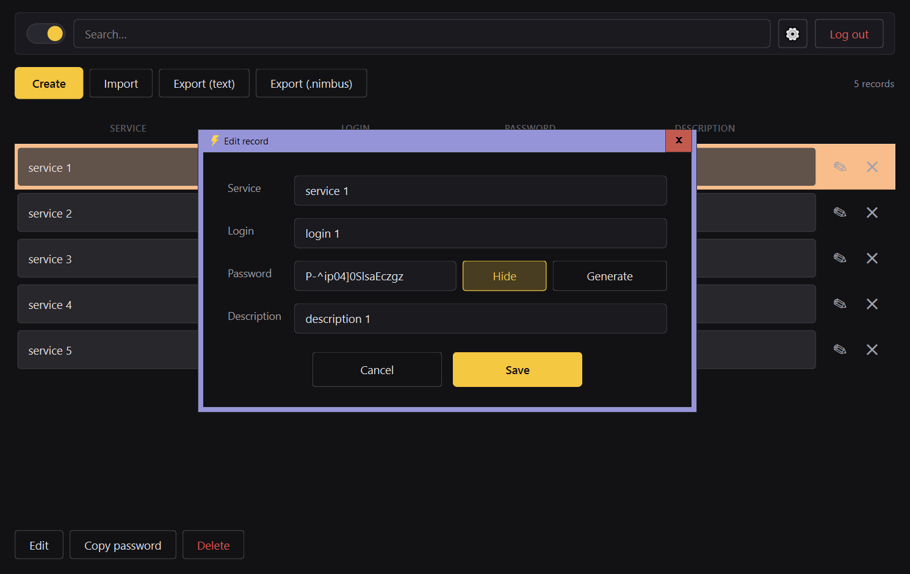
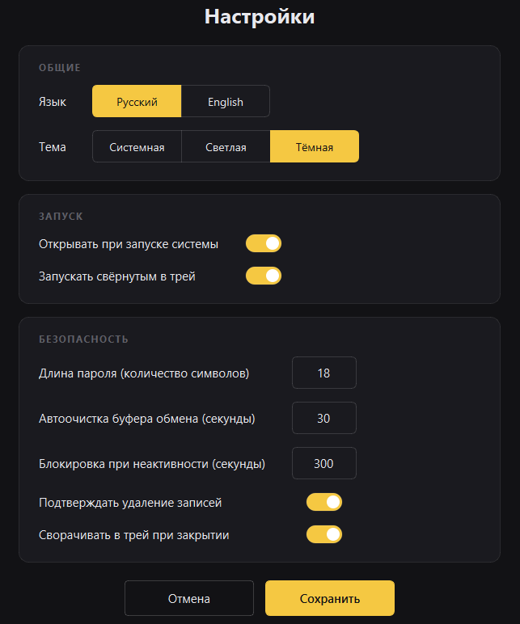

<div align="center">

# ⚡ Nimbus

**Лёгкий менеджер паролей с шифрованием, мультипользовательским режимом и стильным интерфейсом.**

Локальное хранение · AES-128 · PBKDF2-600k · Светлая и тёмная темы · RU/EN

[](https://www.python.org/downloads/)
[](https://pypi.org/project/PyQt6/)
[](LICENSE)
[](https://github.com/your-username/nimbus#-известные-ограничения)

</div>



---

## ✨ Возможности

### Безопасность
- **AES-128 (Fernet)** — аутентифицированное шифрование всех данных (HMAC-SHA256 + AES-CBC).
- **PBKDF2-HMAC-SHA256** с **600 000 итераций** — устойчивый к перебору вывод ключа из мастер-пароля.
- **Отдельная соль** (16 байт из `secrets`) и **meta-файл с версией KDF** — для плавного апгрейда без потери данных.
- **Атомарная запись** всех файлов через `mkstemp + os.replace` — крах процесса не портит хранилище.
- **Автоочистка буфера обмена** через 30 секунд (настраивается).
- **Блокировка сессии при бездействии** (по умолчанию 5 минут) — с закрытием всех открытых диалогов.
- **Задержка на неверный пароль** — 3 попытки, затем экспоненциальный backoff (2 → 4 → 8 → 16 → 30 сек).
- **Single-instance lock** — вторая копия не запустится и не перетрёт данные первой.

### Мультипользовательский режим
- Каждый пользователь хранится в **отдельной папке** `{username}/{username}.nimbus*`.
- **Вход по одному паролю** — программа перебирает всех пользователей и входит под тем, чей пароль подошёл.
- Кнопка **«＋»** на экране входа — быстрое создание нового пользователя.
- Минимум **10 символов** для мастер-пароля.

### Интерфейс
- **Светлая и тёмная темы** + автоматическое определение системной.
- **Русский и английский** языки (переключается на лету).
- **Современные плитки** с плавным hover и подсветкой выбранной строки.
- **Уведомления** о статусе операций прямо в главном окне (без всплывающих попапов).
- **Трей-иконка** — программа живёт в фоне, разлогинивает при закрытии и восстанавливается двойным кликом.

### Работа с данными
- Создание, редактирование, удаление записей (сервис / логин / пароль / описание).
- **Поиск в реальном времени** по сервису, логину и описанию.
- **Генератор паролей** (по умолчанию 18 символов, настраивается).
- **Копирование любого поля** одним кликом по плитке.
- **Показ/скрытие пароля** двойным кликом.
- **Импорт из CSV** (`;`-разделитель).
- **Экспорт в CSV** с BOM-маркером — Excel корректно открывает кириллицу.
- **Экспорт `.nimbus`** — ZIP-архив с зашифрованными файлами пользователя для бэкапа.

### Удобство
- **Автозапуск при старте системы** (Windows registry / Linux autostart).
- **Запуск свёрнутым в трей**.
- **Настройка длины пароля, времени блокировки, автоочистки буфера**.
- **Локализованные диалоги подтверждения** — никаких кривых `QMessageBox`.

---

## 📸 Скриншоты

### Экран входа
Минималистичный вход по одному паролю. Кнопка **＋** справа сверху — создание нового пользователя.



### Главное окно — светлая тема
Плитки с записями, поиск, панель действий, переключатель темы.


### Главное окно — тёмная тема
Тот же интерфейс в тёмной палитре (чёрный + жёлтый акцент).



### Создание / редактирование записи
Поля сервиса, логина, пароля с генератором, описания.



### Настройки
Три секции — **ОБЩИЕ** (язык, тема), **ЗАПУСК** (автозапуск, свёрнутый режим), **БЕЗОПАСНОСТЬ** (длина пароля, таймауты, подтверждение удаления).



---

## 🛠 Зависимости

- **Python 3.10+** (рекомендую 3.11–3.13)
- **PyQt6 ≥ 6.5** — интерфейс
- **cryptography ≥ 41** — шифрование (Fernet + PBKDF2)
- **pyperclip ≥ 1.8** — буфер обмена (опционально, но без него нельзя копировать пароли)
- **pyinstaller ≥ 6** — только для сборки `.exe`, в рантайме не нужен

`requirements.txt`:

```txt
PyQt6>=6.5
cryptography>=41.0
pyperclip>=1.8