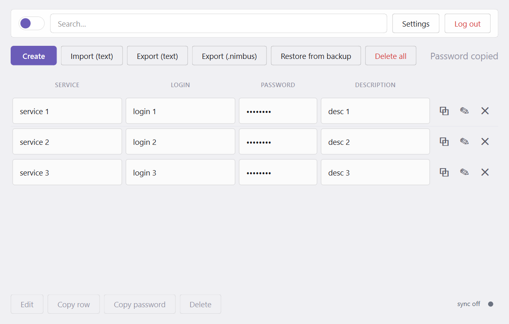
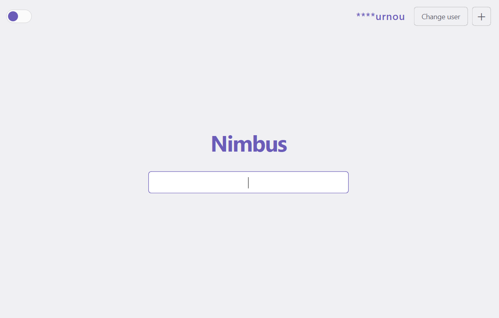
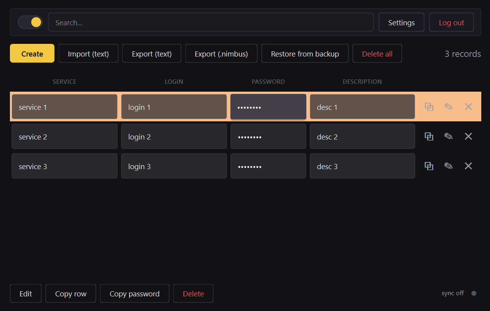
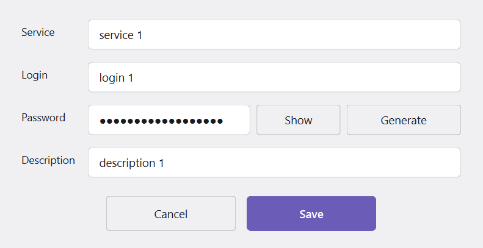
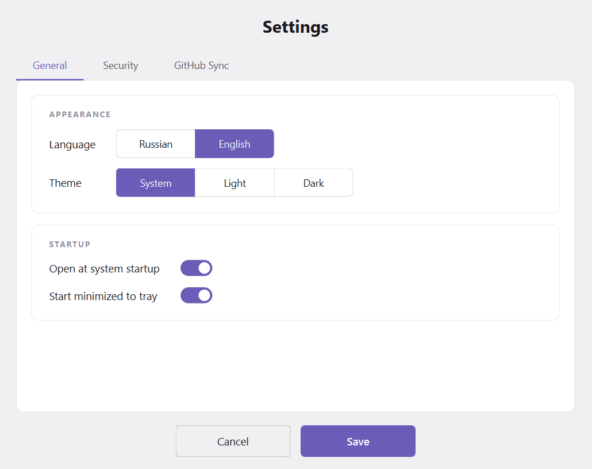
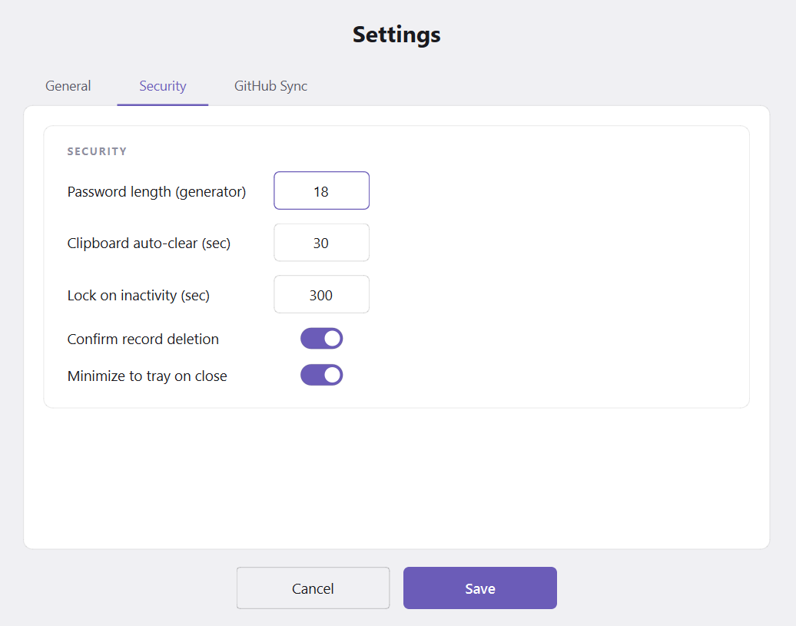
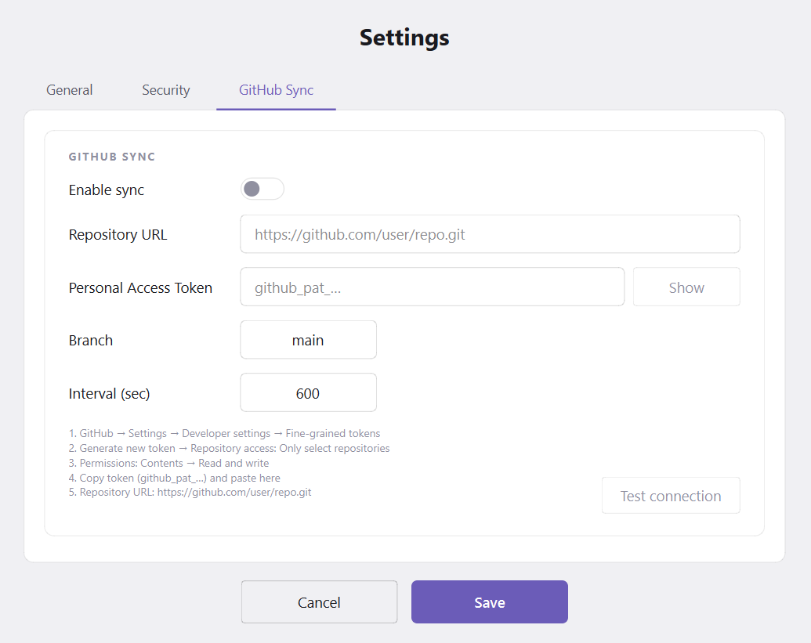

<div align="center">

# ⚡ Nimbus

**Лёгкий офлайн-менеджер паролей с AES-шифрованием, мультипользовательским режимом, автоматическими шифрованными бэкапами и опциональной синхронизацией с GitHub.**

Локальное хранение · AES-128 · PBKDF2-600k · Авто-бэкапы · GitHub Sync · RU/EN · Светлая/Тёмная

[](readme.md)
[](readme.ru.md)

[](https://github.com/birlurnou/nimbus/releases/latest)
[](https://github.com/birlurnou/nimbus/actions/workflows/build.yaml)
[](https://www.python.org/downloads/)
[](https://pypi.org/project/PyQt6/)
[](LICENSE)
[](https://www.microsoft.com/windows)

</div>



---

## Оглавление

- [Что такое Nimbus?](#что-такое-nimbus)
- [Возможности](#возможности)
- [Установка](#установка)
  - [Требования](#требования)
  - [Из исходников](#из-исходников)
  - [Готовые сборки](#готовые-сборки)
- [Гайды](#гайды)
  - [1. Первый запуск — создание пользователя](#1-первый-запуск--создание-пользователя)
  - [2. Управление записями](#2-управление-записями)
  - [3. GitHub Sync — настройка на нескольких устройствах](#3-github-sync--настройка-на-нескольких-устройствах)
  - [4. Бэкапы — локальные и удалённые](#4-бэкапы--локальные-и-удалённые)
  - [5. Импорт / Экспорт](#5-импорт--экспорт)
  - [6. Смена мастер-пароля](#6-смена-мастер-пароля)
  - [7. Настройки](#7-настройки)
  - [8. Трей и автозапуск](#8-трей-и-автозапуск)
- [Безопасность](#безопасность)
- [FAQ](#faq)
- [Структура проекта](#структура-проекта)
- [Участие](#участие)
- [Лицензия](#лицензия)
- [Скриншоты](#скриншоты)

---

## Что такое Nimbus?

Nimbus — **local-first** менеджер паролей: зашифрованное хранилище не покидает
вашу машину, пока вы сами не включите синхронизацию с GitHub. Для тех, кому
важен полный контроль над своими секретами без облачных провайдеров, но
кто хочет держать несколько устройств синхронными.

- **Без телеметрии, без облака, без аккаунтов** — всё это локальные файлы.
- **Шифрованные бэкапы на каждое изменение** — случайное удаление обратимо.
- **Опциональный GitHub Sync** — свой приватный репозиторий как транспорт.
- **Мультипользователь** — семья / команда на одной машине, у каждого свой vault.

---

## Возможности

| Область | Что есть |
|---|---|
| **Безопасность** | AES-128 (Fernet) · PBKDF2-SHA256 600k итераций · своя соль на пользователя · атомарная запись · автоочистка буфера · таймаут сессии · экспоненциальный backoff на неверный пароль |
| **Бэкапы** | Автоснапшот на каждое изменение · хранятся последние 50 · шифруются текущим мастер-паролем · восстановление в один клик · синхронизируются с GitHub (опционально) |
| **Синхронизация** | Git · PAT-аутентификация · слияние по `updated_at` на уровне записей · надгробия удалений (30 дней) · фоновый push/pull · визуальный индикатор |
| **Пользователи** | Несколько vault'ов в папках `{user}/` · вход по одному паролю · быстрое переключение |
| **Данные** | Создание / изменение / удаление · поиск в реальном времени · генератор · копирование поля в 1 клик · копирование строки · массовое удаление · импорт CSV (с дедупом) · экспорт CSV / ZIP |
| **Интерфейс** | Светлая / тёмная / системная темы · RU / EN · живой предпросмотр настроек · трей · автозапуск |

---

## Установка

### Требования

- **Python 3.10+** (рекомендуется 3.11–3.13)
- **Git** в `PATH` — только для GitHub Sync
- Проверено на **Windows 10/11**

### Из исходников

```bash
git clone https://github.com/birlurnou/nimbus.git
cd nimbus
pip install -r requirements.txt
python nimgui.pyw
```

`requirements.txt`:

```txt
PyQt6>=6.5
cryptography>=41.0
pyperclip>=1.8
```

### Готовые сборки

Скачайте последний `.zip` со страницы [Releases](https://github.com/birlurnou/nimbus/releases/latest) — Python ставить не нужно.

---

## Гайды

### 1. Первый запуск — создание пользователя

При первом старте Nimbus просит создать пользователя:

1. Выберите **логин**.
2. Задайте **мастер-пароль** (минимум 10 символов). **Восстановления пароля нет** — запишите его.
3. При желании сразу настройте **GitHub Sync** (**можно настроить позже**, см. [раздел 3](#3-github-sync--настройка-на-нескольких-устройствах)).
4. Нажмите **Создать**.

Хранилище создаётся в `{логин}/{логин}.nimbus`, рядом `…_key`, `…_salt`, `…_meta`. Все файлы зашифрованы — открытыми остаются только salt и meta.

Добавить ещё одного пользователя позже — кнопка **＋** на экране входа.

### 2. Управление записями

Главное окно — плитки (одна запись = одна плитка) с полями **Сервис · Логин · Пароль · Описание**.

- **Один клик** по полю → копирует поле в буфер (очистится через 30 с — значение по умолчанию, настраивается).
- **Двойной клик** по паролю → показать / скрыть.
- **Двойной клик** по любой другой ячейке → открыть запись на редактирование.
- При наведении на строку появляются **3 иконки**:
  - **⧉ Копировать строку** — кладёт `service;login;password;description` одной строкой.
  - **✎ Изменить** — открыть редактор.
  - **✕ Удалить** — удалить (с подтверждением, если включено).

Нижняя панель (для выделенной строки):

- **Изменить** · **Копировать строку** · **Копировать пароль** · **Удалить**

Верхняя панель:

- **Создать** — новая запись.
- **Импорт (CSV)** — см. [раздел 5](#5-импорт--экспорт).
- **Экспорт (text)** — plaintext CSV (спросит мастер-пароль).
- **Экспорт (.nimbus)** — ZIP всей папки пользователя (спросит мастер-пароль).
- **Восстановить из бекапа** — см. [раздел 4](#4-бэкапы--локальные-и-удалённые).
- **Удалить всё** — стирает все записи (двойное подтверждение).

Поиск фильтрует в реальном времени по **сервису / логину / описанию**.

### 3. GitHub Sync — настройка на нескольких устройствах

Nimbus использует **любой приватный Git-репозиторий** как транспорт для зашифрованного vault'а. Файлы пушатся как есть (уже зашифрованы) — GitHub не видит plaintext.

#### Настройка первого устройства (например, дома)

1. Создайте **приватный** репозиторий на GitHub, например `your-name/nimbus-data`. Файлы добавлять не нужно — Nimbus создаст их сам.
2. Сгенерируйте **Fine-grained Personal Access Token**:
   - GitHub → Settings → Developer settings → **Fine-grained tokens** → Generate new token.
   - **Repository access:** Only select repositories → выберите ваш vault-репо.
   - **Permissions:** Contents → **Read and write**.
   - Скопируйте токен (`github_pat_…`).
3. В Nimbus → **Настройки → GitHub Sync**:
   - Включите синхронизацию.
   - URL репозитория: `https://github.com/user/repo.git`.
   - Вставьте PAT.
   - Ветка: `main` (или ваша дефолтная).
   - Интервал: 600 с (по умолчанию 10 мин).
4. **Проверить подключение** → **Сохранить**.

Первый push произойдёт автоматически в течение секунды.

#### Настройка второго устройства (например, на работе)

1. Откройте Nimbus → **＋** на экране входа → вкладка **Восстановить с GitHub**.
2. Вставьте тот же URL и PAT, при необходимости укажите точный `username`.
3. **Восстановить**. Nimbus склонирует репо в рабочую папку.
4. Войдите с **исходным мастер-паролем**.
5. Настройки → GitHub Sync → снова вставьте URL + PAT (они per-machine), проверьте, сохраните.

#### Как разрешаются конфликты

- У каждой записи есть `updated_at` (время последнего изменения).
- Удаления не стираются физически — становятся **надгробиями** (`_deleted=true`, `_deleted_at=<ts>`), которые живут **30 дней**.
- При pull Nimbus сливает локальные и удалённые записи **по ключу `(service, username)`**, выбирая более новую сторону по `updated_at` / `_deleted_at`.
- Удалено на одном, изменено на другом — побеждает более свежий timestamp.
- Два разных пользователя (разные `nimbus_key`) с одинаковым логином — Nimbus откажется: восстановите правильный vault или возьмите другое имя.

#### Что уходит в git

Вся папка `{username}/`: `.nimbus`, `.nimbus_key`, `.nimbus_salt`, `.nimbus_meta`, `.nimbus_settings` и **`backup/`**. **Не** синкается:

- `*.lock` (замки single-instance)
- `.nimbus_sync_state.json` (локальная точка синхронизации)
- папки других пользователей (в коммит попадает только `{username}/`, `.gitignore` и `README.md`)

> **Миграция с v1.2.x:** в вашем `.gitignore` может остаться `**/backup/`. Nimbus 1.3.0 больше не добавляет эту строку, но и не удаляет старые. Удалите её вручную один раз, если хотите, чтобы бэкапы синкались.

### 4. Бэкапы — локальные и удалённые

Каждое мутирующее действие создаёт шифрованный снапшот в `{user}/backup/`:

| Триггер | Имя снапшота |
|---|---|
| Создание пользователя | `alice_YYMMDD_HHMMSS_initial.nimbus` |
| Добавление записи | `…_add.nimbus` |
| Изменение записи | `…_update.nimbus` |
| Удаление записи | `…_delete.nimbus` |
| Удаление всего | `…_delete_all.nimbus` |
| Импорт CSV | `…_import.nimbus` |
| Смена мастер-пароля | `…_chpw.nimbus` |
| Восстановление из бэкапа | `…_restorebackup.nimbus` |

- **Ретеншн:** хранятся последние **50** снапшотов на пользователя. Более старые удаляются автоматически.
- **Формат:** копия `{user}.nimbus` байт-в-байт, **зашифрована мастер-паролем, действовавшим на момент снапшота**.

> ⚠️ **Важно — смена мастер-пароля НЕ перешифровывает старые снапшоты.** Они остаются зашифрованными прежним паролем и не могут быть восстановлены новым. Если планируете менять мастер-пароль — сделайте `.nimbus` ZIP-экспорт (см. [раздел 5](#5-импорт--экспорт)) заранее, чтобы сохранить рабочую аварийную копию.

#### Процесс восстановления

1. Главное окно → **Восстановить из бекапа**.
2. Диалог показывает список (дата / время / действие).
3. Выберите → **Восстановить** → подтвердите.
4. Nimbus проверит, что снапшот расшифровывается текущим паролем, заменит `{user}.nimbus`, перечитает хранилище.
5. Дополнительно создастся снапшот `…_restorebackup.nimbus` от **состояния до восстановления** — можно откатить сам откат.

### 5. Импорт / Экспорт

#### Импорт из CSV

- Разделитель: `;` · Кодировка: UTF-8 с BOM и без.
- Колонки: `service;login;password;description` (описание опционально).
- **Дубликаты пропускаются** по ключу `(service, login)` — и относительно существующих записей, и внутри CSV. В статусной строке выводится, сколько пропущено.
- Требует мастер-пароль (доп. подтверждение).

#### Экспорт в CSV

- Plaintext, `;`, UTF-8 с BOM — Excel корректно открывает кириллицу.
- **Требует мастер-пароль.** После экспорта Nimbus показывает предупреждение: *«file is plaintext — delete it after use»*.

#### Экспорт в ZIP (`.nimbus`-архив)

- Упаковывает всю папку `{user}/`: vault, key, salt, meta, settings (замок пропускается).
- **Требует мастер-пароль.**
- Удобно для «холодного» бэкапа (например, скинуть ZIP на флешку).

### 6. Смена мастер-пароля

**Настройки → Безопасность → Сменить мастер-пароль.**

Двухшаговый диалог:

1. Введите текущий пароль (проверяется).
2. Введите новый дважды. Рядом появляется зелёная галочка, как только оба совпали и длина ≥ 10; красный крестик — если нет.
3. **Сохранить**.

Что происходит после:

- `{user}.nimbus` перешифровывается новым ключом.
- `{user}.nimbus_key` перезаписывается.
- Создаётся снапшот `…_chpw.nimbus` **до** смены (зашифрован *старым* паролем).
- Если включён GitHub Sync, изменения пушатся сразу.
- **Все прежние бэкапы остаются зашифрованными старым паролем** — восстановить их новым нельзя.
- Вы автоматически разлогиниваетесь — войдите новым паролем.

### 7. Настройки

| Вкладка | Что там |
|---|---|
| **Общие** | Язык (RU/EN), тема (Системная/Светлая/Тёмная) — обе применяются как live preview |
| **Безопасность** | Длина пароля (по умолчанию 18), таймаут буфера, таймаут сессии, подтверждение удаления, сворачивать в трей, **Смена мастер-пароля** |
| **GitHub Sync** | Включить, URL репо, PAT, ветка, интервал, **Проверить подключение** |

Все настройки хранятся per-user в `{user}.nimbus_settings` (не синкаются).

### 8. Трей и автозапуск

- Закрытие окна → Nimbus уходит в **системный трей** (настраивается). Сессия при этом **автоматически разлогинивается** — сделано намеренно: незачем держать vault расшифрованным в фоне.
- **Двойной клик** по иконке → открыть.
- **Правый клик** → Открыть / Закрыть программу.
- **Автозапуск**: регистрация в `HKCU\…\CurrentVersion\Run` (Windows) — при включённом «Запускать свёрнутым» стартует в трее.

---

## Безопасность

- **Шифрование:** Fernet (AES-128-CBC + HMAC-SHA256), симметричная аутентифицированная схема из `cryptography`.
- **Key derivation:** PBKDF2-HMAC-SHA256, **600 000 итераций**, 32-байтовый ключ, своя 16-байтовая соль (`secrets.token_bytes`).
- **Проверка пароля:** `{user}.nimbus_key` хранит зашифрованную копию мастер-пароля — логин расшифровывает её и сравнивает; это доказывает ключ, не раскрывая его.
- **Атомарная запись:** каждая запись файла идёт через `mkstemp` в той же папке + `os.replace`.
- **Fail-safe при ошибке расшифровки:** если vault не расшифровывается, Nimbus отказывается стартовать этого пользователя, а не перетирает пустым.
- **Гигиена буфера:** скопированные значения очищаются через 30 с (по умолчанию), и только если в буфере всё ещё то же значение.
- **Таймаут сессии:** через 5 мин неактивности все открытые диалоги закрываются, сессия разлогинивается.
- **Backoff:** 3 неверных попытки → экспоненциальная задержка (2 → 4 → 8 → 16 → 30 с).
- **Git credentials:** PAT используется только в env-переменных per-command — никогда не пишется в `.git/config`, никогда не логируется (ошибки проходят через `_sanitize`, заменяя токен на `***`).

---

## FAQ

**Забыл мастер-пароль. Можно восстановить?**
Нет. Восстановления нет — это и есть zero-knowledge. Восстановите бэкап с тем паролем, которым бэкап был зашифрован, или вытащите всю папку пользователя из GitHub-репо (она всё ещё зашифрована тем паролем).

**Сменил мастер-пароль — бэкапы не открываются.**
Старые бэкапы шифровались старым паролем. Так и задумано. Держите рабочий аварийный бэкап — экспортируйте `.nimbus` ZIP **до** смены пароля.

**В моём репо в `.gitignore` уже стоит `**/backup/` — синк бэкапы не пушит.**
Nimbus 1.3.0 перестал добавлять эту строку, но сохраняет уже существующие. Откройте репо, удалите строку, закоммитьте, запушьте.

**Синк пишет «пользователь уже существует с другим мастер-паролем».**
В удалённом репо папка `{username}/` принадлежит другому пользователю (другой `nimbus_key`). Либо восстановите правильный vault через **Restore from GitHub**, либо возьмите другое имя.

**Git пишет «authentication failed».**
PAT должен иметь `Contents: Read and write` на этот репо. Fine-grained токены истекают — если старше указанного срока, перегенерируйте.

**Можно публичный репо?**
Формально да — vault зашифрован — но наличие `.nimbus_key` и salt это metadata leakage. Используйте **приватный**.

**Где лежат мои файлы?**
Всё относительно папки Nimbus:

```
nimbus/
├── alice/
│   ├── alice.nimbus          ← зашифрованный vault
│   ├── alice.nimbus_key      ← зашифрованная проверка мастер-пароля
│   ├── alice.nimbus_salt     ← 16-байтовая соль (plaintext)
│   ├── alice.nimbus_meta     ← параметры KDF (plaintext)
│   ├── alice.nimbus_settings ← настройки (plaintext JSON)
│   ├── alice.nimbus.lock     ← маркер single-instance
│   └── backup/               ← шифрованные снапшоты
└── bob/ …
```

---

## Структура проекта

```
nimbus.py       ← шифрование, storage, CLI (legacy), бэкапы
nimbus_sync.py  ← GitSync, clone, test_connection
nimgui.pyw      ← PyQt6 GUI
```

---

## Участие

Issues и PR приветствуются. Перед PR прогоните программу у себя — автотестов пока нет.

## Лицензия

MIT — см. [LICENSE](LICENSE).

## Скриншоты

### Экран входа
Минималистичный вход по одному паролю. Кнопка **＋** справа сверху — создание нового пользователя.



### Главное окно — светлая тема
Плитки с записями, поиск, панель действий и индикатор синхронизации в правом нижнем углу.


### Главное окно — тёмная тема
Тот же интерфейс в тёмной палитре (чёрный + жёлтый акцент).



### Создание / редактирование записи
Поля сервиса, логина, пароля с генератором и описания.



### Настройки
Три вкладки — **Общие** (язык, тема, запуск), **Безопасность** (длина пароля, таймауты) и **GitHub Sync** (URL репозитория, PAT, интервал).





